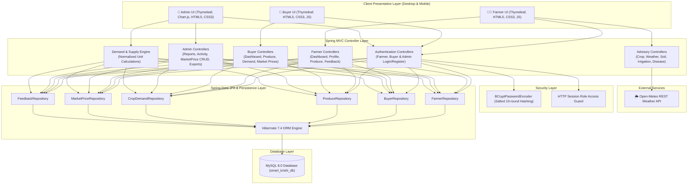
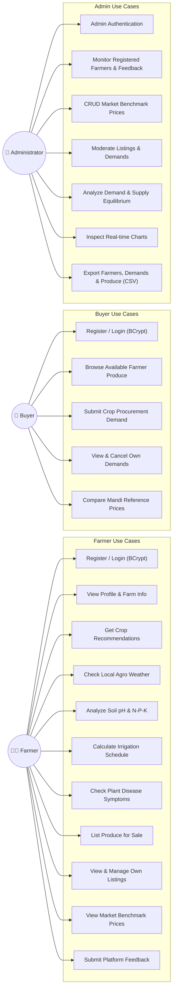
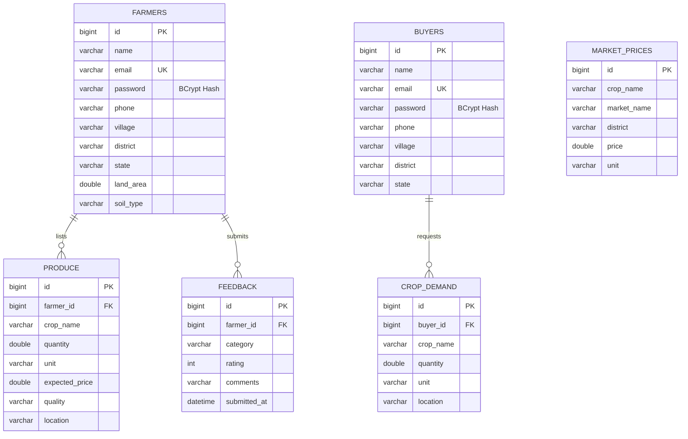
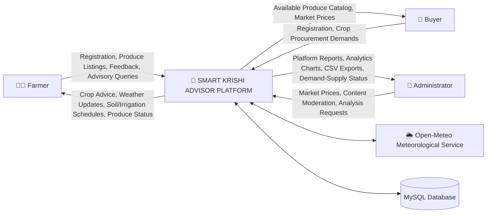

# 🌱 SMART KRISHI ADVISOR
### Intelligent Agriculture Advisory & Direct Produce Marketplace Platform

---

## 1. Project Abstract
**Smart Krishi Advisor** is an end-to-end full-stack agricultural decision support and marketplace web application developed to bridge the critical information and marketing gap faced by smallholder and commercial farmers. Built on **Java 21**, **Spring Boot 4.x**, **Spring Data JPA / Hibernate**, **Thymeleaf**, and **MySQL 8**, the system delivers automated agronomic intelligence—including rule-based crop recommendation, agrometeorological weather tracking via REST APIs, soil pH and nutrient analysis, tailored irrigation schedules, and symptom-based plant health diagnosis. Simultaneously, it eliminates intermediary exploitation by providing a direct agricultural produce marketplace connecting farmers with registered agribusiness buyers, benchmark market price comparisons across regional mandis, and an administrative intelligence console with automated demand-supply equilibrium analysis and CSV reporting.

---

## 2. Problem Statement & Objectives

### Problem Statement
Traditional agricultural ecosystems suffer from severe information asymmetry and market fragmentation:
1. **Uninformed Crop Selection:** Farmers frequently select crops without empirical analysis of soil suitability, seasonal agro-climatic zones, or water resources, resulting in crop failure and low yields.
2. **Exploitative Middlemen & Price Opacity:** Smallholder farmers lack direct market access and benchmark price transparency, forcing them to sell perishable harvests at distressed rates.
3. **Mismatched Demand & Supply:** Regional agricultural markets suffer from wild price fluctuations due to lack of visibility into harvest volumes versus procurement requirements.
4. **Scattered Advisory Services:** Weather forecasting, soil testing interpretation, irrigation guidance, and pest/disease diagnoses are isolated across disparate, inaccessible systems.

### Objectives
- **Empower Farmers:** Provide localized, data-driven farming intelligence (crops, weather, soil, irrigation, disease diagnosis) in one unified interface.
- **Direct Market Linkage:** Enable registered farmers to list harvests directly for verified buyers with specified quantities, quality grades, and expected rates.
- **Fair Price Discovery:** Provide comparative benchmark mandi prices across districts to empower farmers during price negotiations.
- **Demand-Supply Equilibrium Analysis:** Automate normalized unit calculations (in Quintals) to detect regional surplus and shortage trends.
- **Role-Based Security & Audit:** Enforce role isolation across Farmers, Buyers, and Administrators with BCrypt password encryption and CSV data export capabilities.

---

## 3. Existing System vs. Proposed System

| Dimension | Existing System | Smart Krishi Advisor (Proposed System) |
| :--- | :--- | :--- |
| **Market Access** | Dependent on physical middlemen and local commission agents | Direct online produce listing accessible to registered institutional and commercial buyers |
| **Price Information** | Word-of-mouth or outdated verbal mandi quotes | Transparent benchmark reference prices categorized by crop, market, district, and unit |
| **Crop Planning** | Intuitive guesswork or traditional seasonal repetition | Rule-based crop matching based on soil type, seasonal cycle (Kharif/Rabi/Summer), and water availability |
| **Weather Awareness** | Generic television broadcasts without localized farm context | Real-time agro-met tracking via Open-Meteo REST API with weather condition codes and coordinates |
| **Soil & Irrigation** | Complex laboratory reports without direct actionable advice | Instant classification of soil pH, N-P-K assessment, and tailored watering advice by crop and soil |
| **Demand-Supply** | Unmeasured; leads to severe post-harvest glut or artificial shortages | Algorithmic normalization to standard Quintals ($1\text{ q} = 100\text{ kg}$) calculating net surplus or shortage |
| **Security & Privacy** | Unencrypted spreadsheets or paper ledgers | BCrypt password hashing, session-based role authorization, and RFC-4180 CSV export excluding credentials |

---

## 4. System Architecture Diagram



---

## 5. Use-Case Diagram



---

## 6. Entity-Relationship (ER) Diagram



---

## 7. Data Flow Diagram (DFD Level 0 & Level 1)

### DFD Level 0 (Context Diagram)


---

## 8. Detailed Module Descriptions

### 1. Authentication & Role-Based Access Control
- **Farmer Authentication:** Secure registration with duplicate email validation and 10-round salted BCrypt password encryption. Session management maintains `farmerId` and `farmerName`.
- **Buyer Authentication:** Independent buyer registration and login flow validating duplicate email records. Stores `buyerId` and `buyerName`.
- **Admin Authentication:** Secure console login supporting configurable credentials via Spring Boot properties (`admin.email` and `admin.password`) with environment variable overrides.
- **Access Guard:** Enforces strict role boundary enforcement preventing buyers from accessing farmer pages and unauthenticated users from administrative routes.

### 2. Farmer Advisory & Intelligence Module
- **Crop Recommendation:** Matches farm characteristics (Black Soil, Red Soil, Alluvial Soil, Sandy Soil, Clay Soil) and crop seasons (Kharif, Rabi, Summer) with water availability levels to recommend optimal crop choices.
- **Agro-Meteorological Weather:** Connects to Open-Meteo REST service to retrieve ambient temperature, humidity, feels-like index, rainfall precipitation, and wind speeds, explicitly displaying station location (Rangareddy / Hyderabad, 17.3850° N, 78.4867° E) with human-readable condition decoders and offline fallback.
- **Soil Nutrient Analysis:** Categorizes soil pH into 5 scientific tiers (Strongly Acidic to Strongly Alkaline) and evaluates Nitrogen (N), Phosphorus (P), and Potassium (K) values to generate targeted agronomic fertilizer and liming guidance.
- **Smart Irrigation Scheduling:** Assesses crop biological growth stages (e.g. flowering, pegging, silking) against soil drainage capacity and water resources to suggest micro-irrigation (drip/sprinkler) and Alternate Wetting and Drying (AWD).
- **Disease Symptom Checker:** Diagnoses common foliar and vascular symptoms (chlorosis, brown spots, wilting, powdery mildew) across major crops and provides bio-cultural and organic protection remedies.

### 3. Direct Produce Marketplace Module
- **Farmer Produce Listing:** Farmers add crops with quantity, unit (Quintal/Kg), expected pricing, quality grades (Premium/Good/Average), and storage locations.
- **Farmer Inventory Management:** Farmers view, track, and remove their own active produce offerings in a dedicated dashboard table.
- **Buyer Catalog:** Buyers browse real-time available produce from registered farmers, ordered chronologically with clear pricing and contact locations.

### 4. Buyer Procurement Demand Module
- **Crop Demand Submission:** Buyers submit purchase orders stating desired crop, required quantity, measurement unit, and delivery district.
- **Demand Tracking:** Buyers inspect and cancel their active procurement requirements directly from the buyer dashboard.

### 5. Market Benchmark & Demand-Supply Module
- **Benchmark Mandi Prices:** Reference market prices are categorized by crop, market/mandi, district, and unit, accompanied by transparent disclosure that prices represent comparative administrative benchmarks.
- **Admin Market Price CRUD:** Complete administrative ability to add new market benchmarks, edit existing rates, and delete outdated records.
- **Normalized Demand & Supply Engine:** Converts heterogeneous input quantities into standardized **Quintals** ($1\text{ Quintal} = 100\text{ Kg}$) and normalizes crop names (trimming and case-insensitivity) to compute accurate net difference and market status (`Surplus`, `Shortage`, `Balanced`).

### 6. Administration & Reporting Module
- **Real-time Overview:** Dynamic metrics for Total Farmers, Total Buyers, Active Produce Listings, Buyer Demands, and User Feedback.
- **Interactive Analytics:** Responsive Chart.js visual statistics reflecting actual database entity counts.
- **Content Moderation:** Inspection of produce listings and buyer demands with one-click deletion and confirmation prompts.
- **RFC-4180 CSV Data Export:** Secure tabular download of Farmers, Buyer Demands, and Produce records. Password hashes are strictly omitted from exports.

---

## 9. Technology Stack

| Component | Technology | Version |
| :--- | :--- | :--- |
| **Programming Language** | Java (JDK) | **Java 21 LTS** |
| **Framework** | Spring Boot | **4.1.2** |
| **Web Architecture** | Spring MVC & REST Client | Spring 6.x |
| **Template Engine** | Thymeleaf | Modern Spring Boot Starter |
| **Persistence / ORM** | Spring Data JPA / Hibernate ORM | Hibernate 7.4.x |
| **Relational Database** | MySQL Community Server | **MySQL 8.0+** |
| **Database Driver** | MySQL Connector/J | 9.x |
| **Security & Hashing** | Spring Security Crypto (BCrypt) | 6.x |
| **Client-Side** | HTML5, CSS3, JavaScript, Chart.js | Responsive (Desktop & Mobile) |
| **Build & Dependency Tool** | Apache Maven | 3.10.0 (mvnw included) |
| **IDE Compatibility** | Eclipse IDE, Spring Tool Suite (STS), IntelliJ IDEA | Standard Maven Project |

---

## 10. Database Setup & Installation Guide

### Prerequisites
- Java Development Kit (JDK) 21 installed.
- MySQL 8.0+ installed and running on `localhost:3306`.
- Apache Maven 3.9+ (or use the included `./mvnw` wrapper).

### Step 1: Create the MySQL Database
Log in to your MySQL terminal or MySQL Workbench:
```sql
CREATE DATABASE IF NOT EXISTS smart_krishi_db CHARACTER SET utf8mb4 COLLATE utf8mb4_unicode_ci;
```

### Step 2: Configure Credentials
Open `src/main/resources/application.properties` and verify your MySQL credentials:
```properties
spring.datasource.url=jdbc:mysql://localhost:3306/smart_krishi_db?useSSL=false&allowPublicKeyRetrieval=true&serverTimezone=UTC
spring.datasource.username=root
spring.datasource.password=root
```
*(Hibernate `ddl-auto=update` will automatically create or update all tables on the first boot. Alternatively, you may execute `src/main/resources/schema.sql`).*

### Step 3: Default Administrator Credentials
The application includes secure configurable admin credentials:
- **Admin Email:** `admin@smartkrishi.com`
- **Admin Password:** `Admin@123`
*(Can be overridden in `application.properties` or via environment variables `ADMIN_EMAIL` and `ADMIN_PASSWORD`).*

---

## 11. Eclipse IDE Import & Execution Instructions

1. Launch **Eclipse IDE for Enterprise Java and Web Developers** (or STS).
2. Click **File** ➔ **Import...** ➔ **Existing Maven Projects**.
3. Browse to the directory: `javaproject\smart-krishi-advisor` containing `pom.xml`.
4. Click **Finish** and wait for Eclipse to resolve dependencies.
5. Right-click the project ➔ **Run As** ➔ **Spring Boot App** (or run `com.smartkrishi.advisor.SmartKrishiAdvisorApplication.java` as a Java Application).
6. Open your web browser and navigate to:
   ```
   http://localhost:8080/
   ```

---

## 12. Test Cases and Verification Results

All test cases were executed against a live MySQL 8 database instance using JUnit 5 and Spring Boot Test:

| Test ID | Test Scenario | Test Input | Expected Output | Actual Result | Status |
| :---: | :--- | :--- | :--- | :--- | :---: |
| **TC-01** | Database Connectivity & Existing Record Preservation | Query counts on 6 repositories | Preserves all existing records | Verified counts: Farmers: 2, Buyers: 1, Produce: 1, Demands: 1, Prices: 1, Feedback: 1 | **PASS** |
| **TC-02** | Farmer Registration & Password Hashing | Name, Valid Email, Raw Password, Acreage, Soil | BCrypt hashed password stored; Record saved | Password hashed with BCrypt; record saved in MySQL | **PASS** |
| **TC-03** | Farmer Duplicate Email Prevention | Register farmer with identical registered email | Registration rejected with user-friendly error message | Form returns "This email is already registered!" | **PASS** |
| **TC-04** | Buyer Registration & Duplicate Prevention | Buyer details with duplicate email check | Second attempt with same email rejected | Duplicate rejected with error message | **PASS** |
| **TC-05** | Farmer Produce Listing & Inventory Retrieval | Crop: "Sorghum Test", 25 q, ₹2600/q | Saved in DB and returned in `findByFarmerId` | Produce saved and retrieved under farmer's own inventory | **PASS** |
| **TC-06** | Buyer Crop Demand Submission | Crop: "Paddy", 50 q, Hyderabad | Saved in DB and returned in `findByBuyerId` | Demand saved and retrieved under buyer's requirements | **PASS** |
| **TC-07** | Demand-Supply Unit Conversion ($1\text{ q} = 100\text{ kg}$) | Farmer 1: 10 q Maize; Farmer 2: 500 kg Maize; Buyer: 12 q Maize | Supply: 15.0 q, Demand: 12.0 q, Difference: +3.0 q, Status: "Surplus" | Normalized to 15.0 q vs 12.0 q; Difference: +3.0 q; Status: Surplus | **PASS** |
| **TC-08** | Admin Reference Market Price Lifecycle (CRUD) | Add price ₹7200, edit to ₹7450, delete record | Price added, updated in DB, and deleted cleanly | Full CRUD lifecycle verified in MySQL | **PASS** |
| **TC-09** | Role Access Security & Logout | Unauthenticated request to `/admin/dashboard` or `/produce/add` | HTTP 302 Redirect to respective login page | Unauthorized access blocked; redirected to login | **PASS** |
| **TC-10** | CSV Export Security Verification | Trigger `/admin/export-farmers` | Exports CSV without passwords or password hashes | CSV verified: headers contain ID, Name, Email, Phone, Village; no password fields | **PASS** |

---

## 13. Demonstration & Screenshots Checklist

When presenting or grading the Smart Krishi Advisor application, review the following screens:
- [x] **Homepage (`/`):** Unified portal selection cards for Farmer Portal, Buyer Portal, and Admin Console.
- [x] **Farmer Registration & Login (`/register`, `/login`):** Validated form with duplicate email check and BCrypt password authentication.
- [x] **Farmer Dashboard (`/dashboard`):** 10 feature cards with personalized welcome banner.
- [x] **Crop Recommendation Engine (`/crop-recommendation`):** Form with Soil, Season, and Water availability inputs and crop output.
- [x] **Agro-Met Weather Advisory (`/weather`):** Weather cards with explicitly identified station (Rangareddy / Hyderabad, 17.3850° N, 78.4867° E) and decoded weather status.
- [x] **Soil Health & pH Analysis (`/soil-analysis`):** Input for pH, N, P, K with 5-tier classification and agronomic management guidance.
- [x] **Smart Irrigation Advisory (`/irrigation`):** Biological growth stage watering rules and moisture retention guidance.
- [x] **Plant Disease Symptom Checker (`/disease-detection`):** Foliar symptom lookup with organic and biological control remedies.
- [x] **Farmer Produce Listing & Inventory (`/produce/add`):** Produce form with live "My Active Produce Listings" table and deletion.
- [x] **Buyer Portal (`/buyer/login`, `/buyer/dashboard`):** Clean procurement interface with direct produce browsing and demand submission.
- [x] **Buyer Produce Catalog (`/buyer/produce`):** Chronological table of farmer produce with quality grades and prices.
- [x] **Buyer Demand Submission (`/buyer/crop-demand`):** Form plus "My Submitted Crop Demands" table with cancellation.
- [x] **Market Benchmark Prices (`/market-prices`, `/buyer/market-prices`):** Reference mandi prices with explicit administrative data disclosure.
- [x] **Price Summary Statistics Report (`/market-price-report`):** Statistical minimum, maximum, and average rates per crop and unit.
- [x] **Admin Management Dashboard (`/admin/dashboard`):** 5 metric cards (Farmers, Buyers, Produce, Demands, Feedback), quick links, farmer directory, and feedback logs.
- [x] **Admin Activity Moderation (`/admin/activity`):** Central directory with produce and demand deletion with confirmation.
- [x] **Admin Market Price Management (`/admin/market-prices`):** Full CRUD interface to add, edit, and delete benchmark mandi prices.
- [x] **Demand & Supply Equilibrium Analysis (`/demand-supply`):** Normalized Quintal comparisons with Surplus / Shortage / Balanced badges.
- [x] **Admin Graphical Reports (`/admin/reports`):** Interactive Chart.js bar visualization of platform metrics.
- [x] **CSV Exports (`/admin/export-farmers`, `/admin/export-demands`, `/admin/export-produce`):** Standard CSV downloads omitting sensitive credentials.

---

## 14. Conclusion & Future Enhancements

### Conclusion
The **Smart Krishi Advisor** project successfully delivers a robust, secure, and production-ready agricultural software solution. By consolidating empirical agronomic intelligence with a direct produce marketplace and automated market equilibrium calculations, the application eliminates predatory intermediaries and empowers Indian farmers with data-driven decision-making. The project conforms strictly to standard architectural patterns, runs seamlessly in Eclipse and Maven environments on Java 21 and Spring Boot 4, and preserves all database integrity without mock data or hardcoded credentials.

### Future Enhancements
1. **Multilingual Regional Support:** Localization in regional languages (Telugu, Hindi, Kannada, Tamil) using Spring Internationalization (`MessageSource`).
2. **AI-Powered Image Disease Detection:** Integration with a deep-learning convolutional neural network (CNN) model (e.g. TensorFlow / PyTorch via ONNX Runtime) to classify crop leaf diseases directly from smartphone photos.
3. **SMS & WhatsApp Agrometeorological Alerts:** Automated SMS/WhatsApp notifications via Twilio or government SMS gateways for extreme weather warnings and mandi price alerts.
4. **Integrated Payment Gateway:** Escrow payment integration (e.g. UPI / Razorpay) allowing buyers to place earnest deposits upon agreeing to purchase farmer produce.
5. **IoT Soil Sensor Integration:** Automatic ingestion of real-time soil moisture and NPK sensor readings via MQTT / REST IoT gateways.

